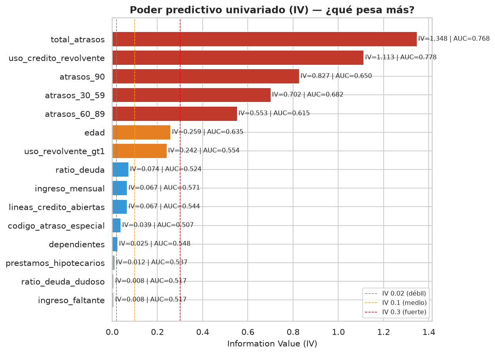
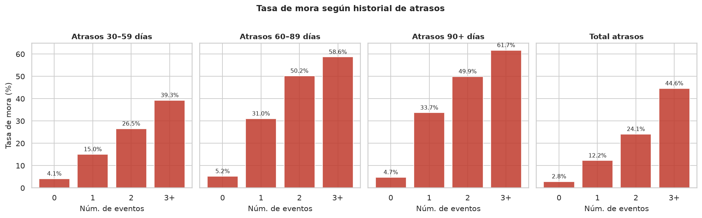
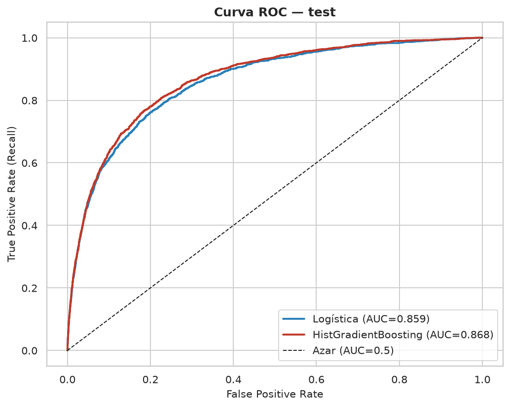
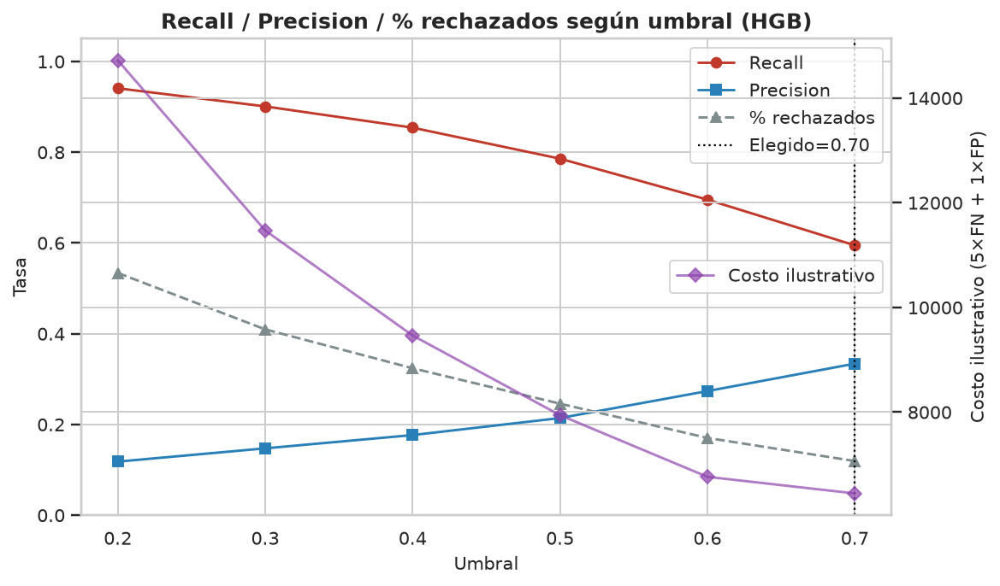

# Give Me Some Credit — Análisis de riesgo crediticio

**Proyecto de portafolio** de [Mario Zarza Zárraga](https://github.com/ZarzaZMario)  
Dataset: competencia Kaggle [Give Me Some Credit](https://www.kaggle.com/c/GiveMeSomeCredit)

---

## Problema

Predecir si un cliente caerá en **mora grave** (≥90 días de atraso) en los siguientes **2 años** (`SeriousDlqin2yrs` → `mora_grave`).

No buscamos solo “el mejor AUC”: documentamos limpieza, hallazgos de negocio y un umbral de decisión explicable para un equipo de riesgo / fintech.

## Datos

- ~150,000 clientes; tasa de mora ≈ **6.68%** (desbalanceado).
- Variables: edad, ingreso, ratio de deuda, uso de crédito revolvente, atrasos 30/60/90, líneas, hipotecas, dependientes.
- Los CSV **no** van al repo (licencia / tamaño). Ver `data/README.md`.

## Enfoque

1. **Limpieza** (`01_limpieza`): nulos, códigos 96/98, outliers, banderas de calidad.  
2. **EDA** (`02_eda`): tasa de mora por segmento + ranking **IV / AUC** univariado.  
3. **Modelo** (`03_modelo`): baseline ingenuo → logística balanceada → HistGradientBoosting; umbral con costo ilustrativo.  
4. **SQL BigQuery** (`sql/`): segmentación y banda de riesgo por reglas (listas para Looker Studio; **no ejecutadas aquí**).

## Resultados clave (test, números reales del notebook)

| Modelo | AUC | Recall@0.5 | Precision@0.5 | Accuracy |
|---|---:|---:|---:|---:|
| Baseline (siempre “sin mora”) | 0.500 | 0.0% | 0.0% | **93.3%** ← trampa |
| Regresión logística (balanced) | **0.859** | 75.3% | 21.9% | 80.4% |
| HistGradientBoosting | **0.868** | 78.6% | 21.4% | 79.3% |

**Umbral elegido (HGB, supuesto ilustrativo costo 5×FN + 1×FP):** **0.70**  
→ recall **59.5%**, precision **33.4%**, rechaza/revisa ≈ **11.9%** de la cartera de test.  
*(El costo 5:1 es un ejemplo didáctico, no un dato del dataset.)*

**Top features (permutation importance, HGB):** `total_atrasos`, `uso_credito_revolvente`, `edad` — alineado con el EDA (IV).

**Señal operativa:** clientes con código de atraso 96/98 → mora histórica ≈ **54.6%**.

## Gráficas principales









## Estructura

```text
gmsc/
├── data/                  # CSV (ignorados por git; ver data/README.md)
├── notebooks/
│   ├── 01_limpieza.ipynb  ✅
│   ├── 02_eda.ipynb       ✅
│   └── 03_modelo.ipynb    ✅
├── reports/
│   ├── figures/           # PNG del EDA y del modelo
│   ├── ranking_iv_auc.csv
│   ├── metricas_test_umbral05.csv
│   ├── tabla_umbrales_hgb.csv
│   └── permutation_importance_hgb.csv
├── sql/                   # BigQuery Standard SQL (para Looker; no corridas aquí)
├── requirements.txt
└── README.md
```

## Cómo reproducir

```bash
python -m venv .venv && source .venv/bin/activate
pip install -r requirements.txt

# 1) Coloca cs-training.csv en data/ (Kaggle Give Me Some Credit)
cd notebooks
jupyter nbconvert --to notebook --execute --inplace 01_limpieza.ipynb
jupyter nbconvert --to notebook --execute --inplace 02_eda.ipynb
jupyter nbconvert --to notebook --execute --inplace 03_modelo.ipynb
```

Opcional: exportar HTML/PDF con `jupyter nbconvert --to html …` y Chrome headless.

## Próximo paso

**Dashboard en Looker Studio** conectado a las consultas de `sql/` (segmentos + banda de riesgo + KPIs). Aún no construido.

## Nota de portafolio

Proyecto educativo / de portafolio. Las decisiones de umbral usan un **costo ilustrativo**. No es un scorecard regulatorio ni consejo financiero.


---

## English (short)

Portfolio credit-risk project on Kaggle’s *Give Me Some Credit* (~150k clients, ~6.7% serious delinquency). Pipeline: cleaning with explicit flags → EDA with IV/AUC ranking → logistic regression vs HistGradientBoosting (test AUC **0.859** / **0.868**) → threshold chosen with an illustrative 5×FN+1×FP cost (threshold **0.70**, recall **59.5%**, precision **33.4%**). BigQuery SQL under `sql/` is ready for a Looker Studio dashboard (next step, not built). Author: [Mario Zarza Zárraga](https://github.com/ZarzaZMario).
